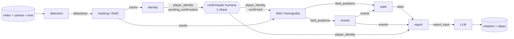

# Arquitetura — BM Scouting

Status: Onda 0 (proposta). Nada aqui está implementado; este documento define fronteiras e contratos.

## 1. Princípios

1. **Módulos desacoplados, JSON como contrato.** Cada etapa lê artefatos JSON de entrada e escreve um artefato JSON de
   saída que valida contra `docs/contracts/v1/`. Nenhum módulo importa código interno de outro.
2. **Cache em disco entre etapas.** Reprocessar a homografia não pode exigir rodar a detecção de novo (GPU = dinheiro).
3. **Humano no circuito onde a máquina é fraca.** A identidade do jogador-alvo passa por confirmação de 1 clique (ADR-0002).
4. **Incerteza explícita.** Todo valor carrega qualidade/confiabilidade; o relatório só pode afirmar o que está em `report_input`.
5. **Medível por etapa.** Cada artefato tem métrica correspondente em [EVALUATION.md](EVALUATION.md) e pode ser comparado
   com ground truth no mesmo formato.

## 2. Pipeline



| # | Etapa | Pacote | Entrada | Saída | Recurso | Onda |
|---|---|---|---|---|---|---|
| 1 | Detecção | `bm_scouting.detection` | vídeo | `detections` | GPU | 1 (jogadores), 3 (bola) |
| 2 | Tracking + reconexão | `bm_scouting.tracking` | `detections` | `tracks` | CPU (GPU se ReID por aparência) | 1 |
| 3 | Identidade | `bm_scouting.identity` | `tracks`, vídeo (recortes), consulta | `player_identity` | GPU (leitura de número) | 1 |
| 3h | Confirmação humana | CLI (Onda 1) / UI (Onda 5) | `player_identity` pendente | `player_identity` confirmado | humano | 1 |
| 4 | Campo | `bm_scouting.field` | `tracks`, `player_identity`, vídeo | `field_positions` | CPU/GPU (depende ADR-0001) | 2 |
| 5 | Eventos | `bm_scouting.events` | `field_positions` | `events` | CPU | 3 |
| 6 | Estatísticas | `bm_scouting.stats` | `field_positions`, `events` | `stats` | CPU | 2–4 |
| 7 | Relatório | `bm_scouting.report` | `stats`, `events`, `player_identity` | `report_input` → texto | API LLM | 4 |
| — | Orquestração/cache | `bm_scouting.pipeline` | — | — | CPU | 1 |

Na Onda 1 a saída final é a trajetória do alvo em **coordenadas de imagem** (extraída de `tracks` + `player_identity`);
`field_positions` só aparece na Onda 2.

### Por que a identidade vem antes do campo

O produto é **individual**: só precisamos de identidade confiável para **um** jogador. Os demais precisam apenas de
rótulo de time (para eventos como passe/desarme). Isso transforma "MOT perfeito de 22 jogadores por 90 min" — problema em
aberto — em "recuperar os tracklets do alvo com verificação humana", que é tratável (ver ADR-0002 e ADR-0003).

## 3. Cache de artefatos intermediários

Layout proposto (diretório `data/`, **fora do controle de versão**, nunca sincronizado em nuvem pessoal/corporativa — ver RISKS R-15):

```
data/
  videos/<match_id>/<video_sha256>.<ext>          # entrada, imutável
  artifacts/<match_id>/<schema_name>/<cache_key>.json[.gz]
  artifacts/<match_id>/<schema_name>/latest.json   # ponteiro para a última chave válida
  gt/<match_id>/...                                 # ground truth (mesmos contratos)
  runs/<run_id>/metrics.json                        # saídas de avaliação
```

**Chave de cache** de uma etapa:

```
cache_key = sha256( schema_name
                  + schema_version
                  + module_version
                  + sha256(config canônica da etapa)
                  + sha256 de cada artefato de entrada, em ordem )
```

Regras:
- Se `artifacts/<match>/<schema>/<cache_key>.json` existe e valida contra o schema, a etapa é pulada.
- Mudou código (bump de `module_version`), config ou qualquer entrada → chave nova → recomputa essa etapa e as seguintes.
- Artefato só é gravado após validar contra o schema; gravação atômica (arquivo temporário + rename).
- A confirmação humana gera um **novo** `player_identity` (status `confirmed`/`corrected`) cujo hash invalida as etapas
  a jusante; a versão pendente é mantida para auditoria.
- `module_version` segue semver e é responsabilidade do dono do módulo incrementar ao mudar comportamento.

## 4. Sistemas de coordenadas

- **Imagem:** pixels da resolução original, origem no canto superior esquerdo, bbox `[x1, y1, x2, y2]`.
  Ponto de contato com o gramado = centro da base da bbox.
- **Campo:** metros, vista superior canônica; `x ∈ [0, length_m]` ao longo do comprimento, `y ∈ [0, width_m]` ao longo da
  largura. Dimensões declaradas ou assumidas ficam em `field.dimensions_source`. Direção de ataque por período em `periods`.
- **Tempo:** `frame_index` é a referência; `timestamp_s = frame_index / fps` (vídeo de fps variável é tratado na ingestão — Onda 1).

## 5. Modos de execução

| Modo | Onda | Como roda |
|---|---|---|
| CLI local | 1–4 | `python -m bm_scouting.pipeline ...` (a definir na Onda 1) em CPU para etapas leves; etapas GPU em máquina alugada com o mesmo código e o mesmo layout `data/`. |
| Protótipo Streamlit | 5 | UI chama o mesmo pipeline; confirmação de 1 clique vira tela. |
| Produção | 5 | FastAPI recebe upload → fila de jobs → worker GPU executa etapas 1–4 → worker CPU executa 5–7 → storage de objetos. Limites por plano aplicados na entrada da fila. |

A unidade de reprodutibilidade (Onda 1) é uma imagem de contêiner com versões fixadas, usada tanto no desenvolvimento em
GPU alugada quanto no worker de produção (ADR-0004).

## 6. Tratamento de falhas e qualidade

- Etapa que não consegue produzir resultado útil grava o artefato com marcadores de qualidade (`status: failed`,
  `reliability: unavailable`, `source: interpolated`) em vez de abortar silenciosamente ou inventar valor.
- `stats.coverage` é obrigatório: o relatório declara quanto da partida sustenta cada número.
- O job falha (não entrega relatório) se a identidade não for confirmada nem auto-aceita segundo critérios da ADR-0002.

## 7. Fora do escopo desta arquitetura (decidir depois, por ADR)

- Formato físico de artefatos grandes (ADR-0005).
- Escolha concreta de modelos (detector, leitor de número, ReID) — Ondas 1–3, com medição e checagem de licença (ADR-0006).
- Banco de dados, autenticação, cobrança — Onda 5.
