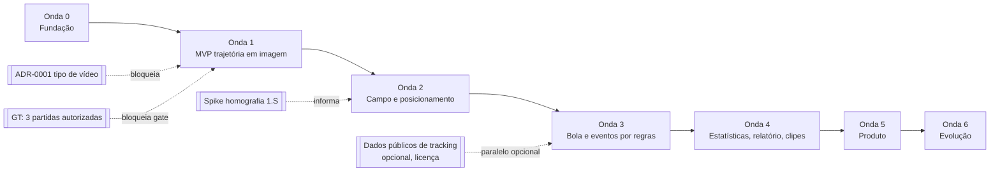

# Roadmap — ondas, fases e gates

Cada onda termina com: (1) entregáveis, (2) **gate de saída com critérios binários** (PASSOU/FALHOU com evidência) e
(3) relatório de auditoria em `docs/audits/WAVE-<n>.md`, escrito pelo papel QA/Auditor. Uma onda só começa quando o gate
da anterior passou **e** os itens do seu "gate de entrada" estão resolvidos.

Valores-alvo citados vêm de [EVALUATION.md](EVALUATION.md) e são **a calibrar com dados reais** até serem congelados
antes da medição no holdout. Durações não são estimadas aqui: serão medidas.

## Visão geral e dependências

## Ajustes ao plano original (com justificativa)

| # | Ajuste | Justificativa |
|---|---|---|
| J1 | **Spike de homografia** (fase 1.S) antecipado para a Onda 1, com tempo limitado, sem código de produto, só relatório medido | Achado de auditoria 1: homografia dinâmica é pesquisa e deve vir cedo. Descobrir na Onda 2 que é inviável desperdiçaria a Onda 1. |
| J2 | **Ground truth e política mínima de dados** viram a fase 1.0 da Onda 1 | Sem GT o gate da Onda 1 não é mensurável (achado 6). LGPD/direitos não podem esperar a Onda 5: já na Onda 1 manipulamos imagem de pessoas, possivelmente menores. |
| J3 | **ADR-0006 (licença do detector)** decidida antes da fase 1.2 | Evita treinar/ajustar sobre um detector AGPL e ter de migrar depois. |
| J4 | Onda 1 entrega trajetória em **imagem** + `player_identity` confirmado; `stats` mínimo (cobertura) só a partir da Onda 2 | Mantém a Onda 1 pequena e testável; métricas físicas sem homografia não têm significado. |
| J5 | Desenvolvimento de `events`/`stats` **opcionalmente em paralelo** a partir de dados públicos de posições (sem vídeo), alimentando o contrato `field_positions` | Desacopla a Onda 3 da qualidade da visão; depende de licença verificada. Opcional. |

---

## Onda 0 — Fundação (esta entrega)

**Entregáveis:** CLAUDE.md; ROADMAP; ARCHITECTURE; contratos v1 + exemplos; EVALUATION; ADRs 0001–0006; COST_MODEL;
RISKS; AGENTS; esqueleto (`pyproject.toml`, `src/`, `tests/`, `Makefile`).

**Gate de saída (binário):**
- G0.1 Todos os arquivos de entregáveis existem.
- G0.2 `python -m pytest` passa (schemas válidos, exemplos válidos, mutações inválidas rejeitadas, pacotes importam).
- G0.3 Cada contrato do pipeline tem schema versionado e exemplo.
- G0.4 Cada etapa tem ao menos uma métrica com alvo marcado "a calibrar".
- G0.5 ADRs obrigatórias (0001–0004) existem com opções, trade-offs e recomendação.
- G0.6 Nenhum código de ML no repositório; nenhum dado/vídeo baixado.
- G0.7 Nenhum número de desempenho apresentado como medido.

**Gate de entrada da Onda 1 (decisões humanas):** ADR-0001, ADR-0004 e ADR-0006 aceitas; repositório sob git fora do
OneDrive (R-15/R-16); ao menos 1 partida do tipo escolhido com autorização escrita.

---

## Onda 1 — MVP: vídeo → trajetória do alvo em coordenadas de imagem (CLI)

| Fase | Conteúdo | Saída | Papel |
|---|---|---|---|
| 1.0 | Política mínima de dados (autorização, retenção, sem menores sem consentimento); coleta de 3 partidas; guia de anotação; anotação camadas A–E; congelar GT | `data/gt/`, manifesto, OPS-5 medido | QA + humanos |
| 1.1 | Ingestão (metadados, hash, fps), orquestração e cache conforme ARCHITECTURE §3; validação de artefatos; ADR-0005 medida | `pipeline` + testes | Backend/Infra |
| 1.2 | Detector escolhido (ADR-0006) e medido | `detections` | Vision |
| 1.3 | ByteTrack + reconexão espaço-temporal (ADR-0003 etapa A) | `tracks` | Tracking/ReID |
| 1.4 | Time por cor, leitura de número, votação, candidatos, confirmação de 1 clique na CLI (ADR-0002) | `player_identity` | Identidade |
| 1.5 | Exportação da trajetória do alvo (imagem) + script de avaliação | JSON de posições, `metrics.json` | QA |
| 1.S | Spike de homografia no tipo de vídeo-alvo (paralelo, limitado no tempo) | Relatório com FLD-1/FLD-2 em frames do GT | Campo |

**Gate de saída:**
- G1.1 CLI processa as 3 partidas de ponta a ponta sem intervenção além da confirmação de identidade.
- G1.2 Todos os artefatos produzidos validam contra os schemas v1.
- G1.3 Reexecução sem mudança usa 100 % de cache (nenhuma etapa GPU roda) — evidência por log.
- G1.4 No holdout: DET-1, DET-2, TRK-2, TRK-3, TRK-4, IDN-1, IDN-3, IDN-4 ≥ alvos congelados.
- G1.5 TRK-1 reportado antes/depois da reconexão; IDN-5 e IDN-6 reportados.
- G1.6 OPS-1 e OPS-2 medidos e COST_MODEL atualizado com valores reais.
- G1.7 Relatório do spike 1.S com recomendação para a Onda 2.

---

## Onda 2 — Campo e posicionamento

Fases: 2.1 homografia (estática/keyframes conforme spike) · 2.2 projeção do ponto de pé em metros, suavização ·
2.3 mapa de calor e distância percorrida · 2.4 `stats` mínimo (cobertura, distância, heatmap).

**Gate de saída:** G2.1 FLD-1 e FLD-2 ≥ alvo no holdout · G2.2 FLD-3 ≥ alvo · G2.3 FLD-4 ≥ alvo, reportado com e sem
suavização · G2.4 `field_positions` e `stats` validam · G2.5 STA-1 (recomputação determinística) passa.

## Onda 3 — Bola e eventos por regras

Fases: 3.1 anotação GT camadas F–G · 3.2 detector de bola dedicado · 3.3 posse por proximidade · 3.4 passes, chutes,
desarmes por heurística geométrica versionada (`rules.ruleset_version`).

**Gate de saída:** G3.1 DET-3 ≥ alvo · G3.2 EVT-1..EVT-5 ≥ alvos no holdout · G3.3 toda regra tem teste unitário com
cenário sintético · G3.4 `events` validam.

## Onda 4 — Estatísticas, relatório e clipes

Fases: 4.1 `stats` completo com `reliability` · 4.2 `report_input` + prompt do LLM restrito a fatos · 4.3 verificador
automático de números/citações · 4.4 recorte de clipes a partir de `highlights`.

**Gate de saída:** G4.1 REP-1 = 0 em todos os relatórios gerados para o GT · G4.2 REP-2 = 100 % · G4.3 REP-3 ≥ alvo ·
G4.4 STA-2 reportado · G4.5 clipes cobrem os `highlights` (contagem igual, tempos dentro do vídeo).

## Onda 5 — Produto

Fases: 5.1 protótipo Streamlit (upload, confirmação de 1 clique, relatório) · 5.2 parecer jurídico (direitos, LGPD,
menores), termos de uso, RIPD · 5.3 FastAPI + fila + worker GPU + storage (nova ADR de infraestrutura) · 5.4 autenticação,
limites por plano, cobrança recorrente · 5.5 retenção e exclusão de dados.

**Gate de saída:** G5.1 job ponta a ponta via API com usuário de teste · G5.2 OPS-2/OPS-3/OPS-4 medidos em carga de teste ·
G5.3 exclusão de dados do titular executada e verificada · G5.4 parecer jurídico arquivado e pendências fechadas ·
G5.5 limites por plano aplicados (teste automatizado).

## Onda 6 — Evolução

Classificação de ações com modelos de vídeo (a partir de dataset próprio acumulado com base legal), ReID C/D
(ADR-0003), suporte a vídeo de TV (ADR-0001 opção A), otimização de custo e escala. Cada item entra com ADR própria e
gate medido contra a versão por regras.
